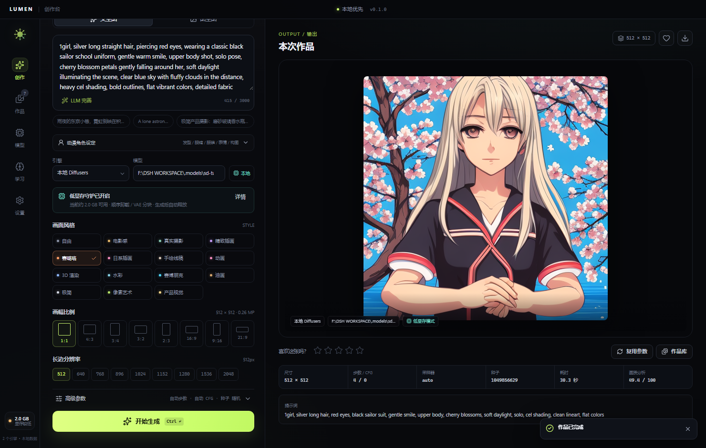
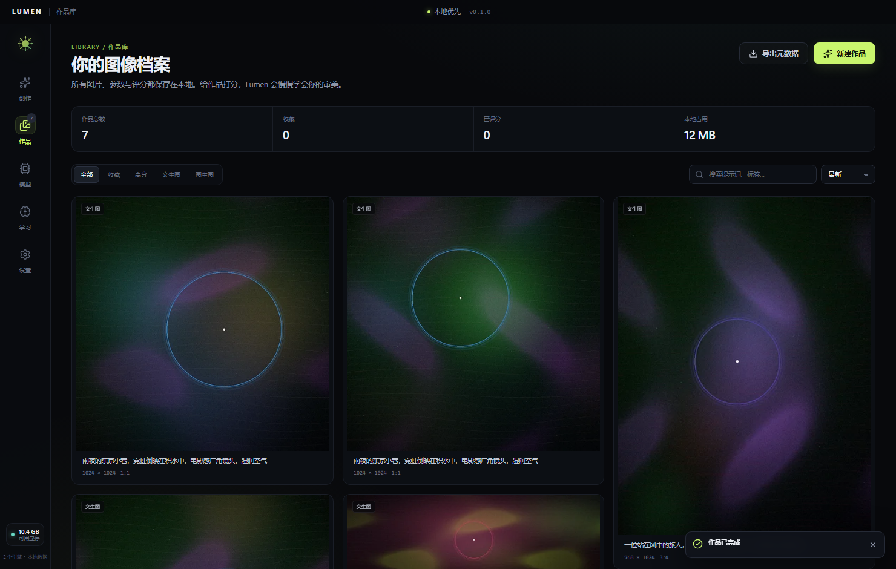
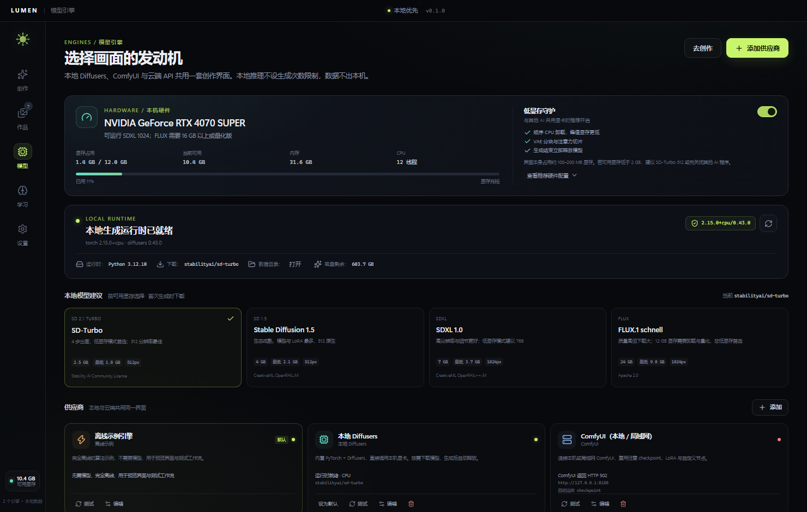
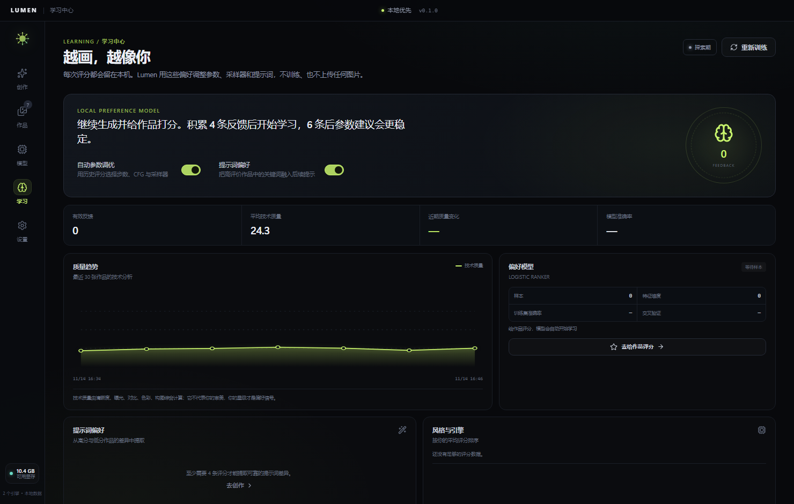
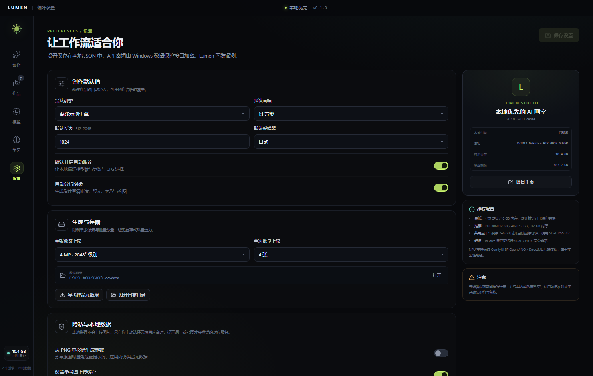
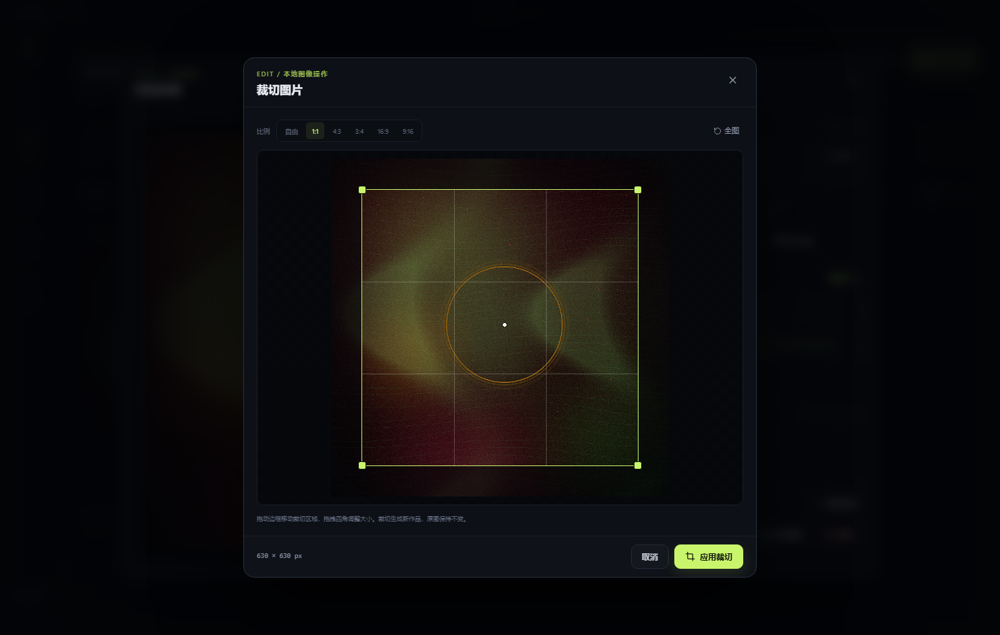
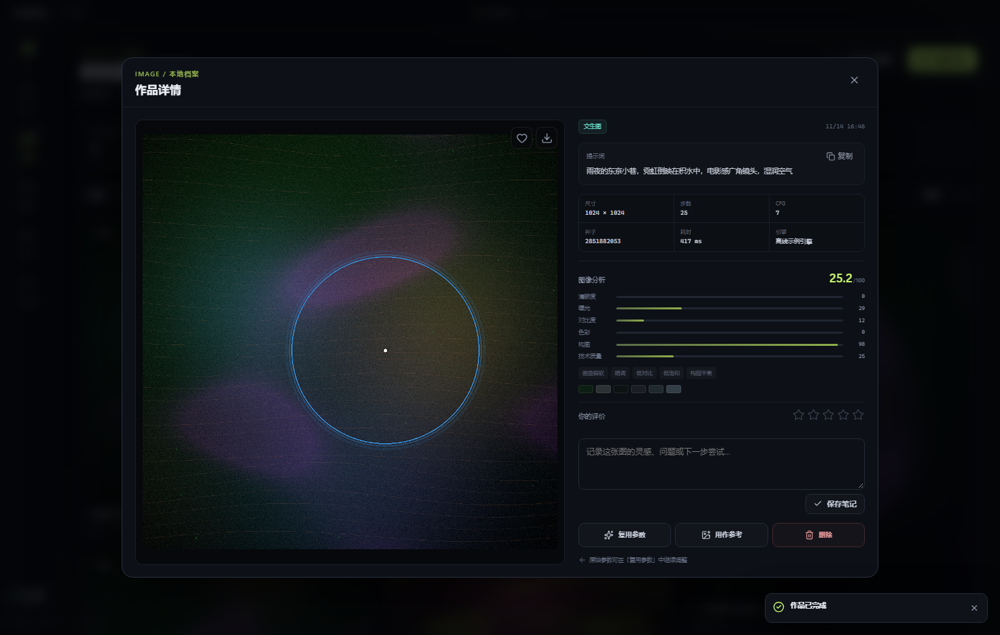
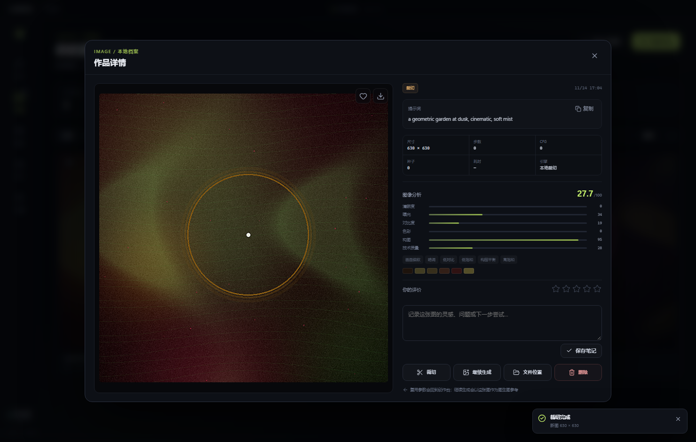

# Lumen Studio · 流明画室

**本地优先的 AI 图像工作室。** 文生图、图生图、尺寸控制、本地/云端模型统一管理，并在本机从你的评分中持续学习。

Lumen Studio 是一个 Windows 桌面应用：Electron 负责界面，Python 负责生成与图像分析，数据完全保存在本地。它不绑定某一个模型，也不要求把图片上传到任何服务器。



| 作品库 | 模型与显存 |
| --- | --- |
|  |  |

| 本地学习 | 设置 |
| --- | --- |
|  |  |

| 动漫角色 + 本地 LLM | 裁切 |
| --- | --- |
|  |  |

| 作品详情 | 裁切结果 |
| --- | --- |
|  |  |

## 目录

- [为什么是 Lumen](#为什么是-lumen)
- [功能](#功能)
- [硬件要求与显存策略](#硬件要求与显存策略)
- [安装](#安装)
- [使用](#使用)
- [接入模型](#接入模型)
- [本地学习是怎么工作的](#本地学习是怎么工作的)
- [开发](#开发)
- [打包与发布](#打包与发布)
- [隐私与安全](#隐私与安全)
- [当前限制](#当前限制)
- [常见问题](docs/FAQ.md)
- [路线图](#路线图)
- [许可证](#许可证)

## 为什么是 Lumen

多数 AI 绘图工具要么完全依赖云端，要么要求你先装一整套 ComfyUI / Python 环境。Lumen 把两者放进同一个可安装的桌面应用：

- **本地优先**：默认走本机显卡，图片、提示词、评分、分析结果都在本地。没有遥测。
- **模型自由**：内置 Diffusers 运行时，也可以连接现有 ComfyUI、OpenAI Images、Stability AI 或任意 OpenAI 兼容图片端点。
- **低显存友好**：为“显卡上还跑着别的 AI”这一常见场景设计。监控空闲显存，自动启用顺序 CPU 卸载、VAE 分块与生成后释放。
- **会学习**：你的星级与收藏会训练一个本地偏好模型，自动调整步数、CFG、采样器，并从高分提示词中提取偏好片段。不是黑盒“AI 优化”。
- **可发布**：一条 `npm run dist` 生成 NSIS 安装包，自动创建桌面快捷方式与卸载入口，GitHub Actions 可直接出 Release。
- **图标也是生成的**：桌面图标由本地 SD-Turbo 图生图生成，保持深色 + 青柠光圈视觉；见 [ICON.md](docs/ICON.md)。

## 功能

### 创作

- 文生图 / 图生图，支持拖拽参考图
- 长宽比预设：1:1、4:3、3:4、3:2、2:3、16:9、9:16、21:9，自定义长边 512–2048
- 支持精确像素、步数、CFG、种子、采样器、批量 1–4 张
- 15 种风格预设（含赛璐珞 / 日系插画 / 手绘线稿）；可选用“提示词增强”
- 动漫角色构建器：人数、发型、眼睛、服装、表情、动作、景别、背景
- 可选赛璐珞线条增强后处理
- 生成进度、取消、批量缩略图、收藏、下载、复用参数、以图生图
- 作品操作：裁切、继续生成、评分、笔记、定位原文件、删除文件
- SmartScreen 指引：安装包旁 `SMARTSCREEN.txt` 与 [说明文档](docs/WINDOWS_SMARTSCREEN.md)

### 模型引擎

| 引擎 | 说明 | 需要网络 |
| --- | --- | --- |
| 本地 Diffusers | 内置 PyTorch + Diffusers，直接调用 CPU / NVIDIA GPU。首次使用时下载模型 | 仅下载模型时 |
| ComfyUI | 连接本机或局域网 ComfyUI，复用任意 checkpoint、LoRA 与自定义节点 | 局域网 |
| OpenAI Images | `gpt-image-1` / DALL·E，或任意 OpenAI 兼容图片端点 | 是 |
| Stability AI | SD 3.5 / Core API，支持文生图与图生图 | 是 |
| 离线示例 | 无需模型，生成算法抽象画，用于预览与测试工作流 | 否 |

### 动漫与本地 LLM

- 面向手绘赛璐珞动漫角色；风格、角色构建器与负向词均针对动漫优化
- 接入 OpenAI 兼容本地 LLM（如 `http://127.0.0.1:8000/v1`），把中文角色想法改写为 Danbooru 风格英文 tags
- 详细工作流：[ANIME.md](docs/ANIME.md)

### 学习

- 自动图像分析：清晰度、曝光、对比度、色彩丰富度、构图、技术质量、主色板、感知哈希相似度
- 星级 / 收藏 → 本地偏好模型（逻辑回归排序器）
- 自动推荐步数、CFG、采样器；可随时关闭
- 从高分/低分作品中提取正负相关提示词
- 质量趋势与学习阶段可视化；所有反馈可在界面中查看

## 硬件要求与显存策略

> 本软件在 **Windows 10/11 x64** 上开发和测试。本地 AI 推理对硬件有真实要求；应用本身很轻，但扩散模型不是。

| 档位 | CPU | 内存 | 显卡 / 显存 | 体验 |
| --- | --- | --- | --- | --- |
| **最低** | 4 核现代 CPU | 16 GB | 无独显（CPU 推理） | SD 1.5 / SD-Turbo 512，约 1–5 分钟/张 |
| **推荐** | 6 核以上 | 32 GB | **RTX 3060 12 GB / RTX 4070 / 4070 SUPER 12 GB** 或同级 | SDXL 1024 或 SD-Turbo 快速出图 |
| **共用显卡** | 6 核以上 | 32 GB | 剩余显存 **≥ 2 GB** | 低显存模式：SD-Turbo 512 + 顺序卸载 |
| **舒适** | 8 核以上 | 64 GB | RTX 4080 / 4090 16–24 GB | FLUX / SD 3.5 / SDXL 高分辨率 |

**RTX 4070 SUPER 12 GB 是明确推荐配置。** 如果显卡同时跑着本地 LLM（例如占用约 10 GB），剩余约 1.5–2 GB 时：

1. 使用 **SD-Turbo 512**，不要一上来选 SDXL 1024。
2. 在「模型」或「设置」中开启 **低显存守护**（默认开启）。
3. 应用会启用 `enable_sequential_cpu_offload`、注意力切片、VAE 分块，并在每张图完成后释放模型与 CUDA 缓存。
4. 如果仍然 OOM，先关闭其他 AI 程序，或把引擎切到 ComfyUI / 云端。界面本身只占约 100–200 MB 显存。

应用会在「模型」页显示当前显卡总显存、已用、可用，以及根据**实时空闲显存**给出的档位建议。GPU 数据每 5 秒刷新一次。

### NPU

内置 Diffusers 引擎目前自动选择 **CUDA 或 CPU**。NPU（Intel AI Boost / AMD Ryzen AI / 高通 Hexagon）可以通过 ComfyUI 的 OpenVINO / DirectML 后端或其他 ONNX 运行时使用，属于实验性路径；应用会在界面中明确标注。

## 安装

### 方式一：安装包（推荐给普通用户）

1. 从 [GitHub Releases](https://github.com/7ather-LX/lumen-studio/releases) 下载 `Lumen-Studio-Setup-x.y.z.exe`。
2. 双击安装。安装器为当前用户安装，自动创建**桌面快捷方式**和开始菜单项。
3. 首次启动如需真实本地生成，在「模型」页点击 **安装本地引擎**。这会下载 PyTorch + Diffusers（CUDA 约 3–6 GB，CPU 约 1.5 GB），安装到应用自己的 Python 运行时，不会污染系统 Python。
4. 选择一个模型。首次生成时会从 Hugging Face（或你配置的镜像）下载权重。

卸载：Windows「设置 → 应用」或开始菜单中的卸载入口。默认**保留**作品与设置；如需彻底清除，手动删除 `%APPDATA%\Lumen Studio`。

> 本构建已用本机自签名证书签名，但 Windows SmartScreen 仍可能提示“无法识别的应用”。点「更多信息 → 仍要运行」即可。完整说明见 [WINDOWS_SMARTSCREEN.md](docs/WINDOWS_SMARTSCREEN.md)。自签名证书不等同于 CA 发布者信誉；正式公开分发建议购买 OV/EV 代码签名证书。

### 方式二：从源码运行

前置：Windows 10/11、Python 3.12、Node.js 22+、pnpm 或 npm。

```powershell
git clone https://github.com/7ather-LX/lumen-studio.git
cd lumen-studio

python -m venv .venv
.\.venv\Scripts\python.exe -m pip install -r backend\requirements-dev.txt

npm install
node node_modules\electron\install.js

npm run dev
```

开发模式下 Electron 会自动启动 `.venv` 中的 FastAPI 后端。只调试网页界面：

```powershell
# 终端 1
npm run backend:dev

# 终端 2
npm run dev:web
# 浏览器打开 http://127.0.0.1:5173
```

## 使用

1. **选择引擎**：默认是离线示例。安装本地运行时后选择「本地 Diffusers」。
2. **写提示词**：主体、光线、材质、镜头、氛围。中文可用，但多数开源模型对英文提示更敏感。
3. **选画幅与分辨率**：长边 1024 是 SDXL 的舒适区；SD-Turbo 用 512。
4. **生成**：`Ctrl+Enter` 也可以提交。
5. **评分**：在结果下方点星或收藏。积累 6 条反馈后，「学习」页开始给出参数建议。
6. **复用**：在作品详情中「复用参数」或「用作参考」回到创作台。

### 图生图

拖入参考图，设置重绘强度 `0.1–1.0`。强度越高，越偏离原图。低显存下建议 512 长边、SD-Turbo。

## 接入模型

详见 [PROVIDERS.md](docs/PROVIDERS.md)。

### 本地 Diffusers

- 模型可以是 Hugging Face ID（`stabilityai/sd-turbo`）或本地 Diffusers 文件夹。
- 国内网络可在供应商设置中填 `https://hf-mirror.com`。
- 推荐顺序：SD-Turbo → SD 1.5 → SDXL 1.0 → FLUX（显存要求高）。
- 首次下载需要网络；之后可开启「仅使用本地缓存」完全离线。

### ComfyUI

先启动 ComfyUI（默认 `http://127.0.0.1:8188`），然后在「模型」页编辑 ComfyUI 供应商：

- 填服务地址，点「测试」。
- 点「获取」读取 `/object_info/CheckpointLoaderSimple` 的 checkpoint 列表。
- 若 ComfyUI 前面有反向代理认证，在 API Key 中填 Bearer token。

应用使用一个内置的最小工作流（Checkpoint → CLIP → KSampler → VAE Decode → SaveImage），不会修改你的 ComfyUI 配置。你可以用 ComfyUI 的 `--lowvram` 启动参数进一步降低显存。

### 云端

- **OpenAI**：`https://api.openai.com/v1`，模型 `gpt-image-1` / `dall-e-3`。DALL·E 3 不支持图生图。
- **Stability**：`https://api.stability.ai`，模型 `sd3.5-large` / `sd3.5-medium` / `core`。
- **OpenAI 兼容**：任何接受 `/images/generations` 与 `/images/edits` 的服务。Base URL 需包含 `/v1`（如 `https://api.siliconflow.cn/v1`）。

云端请求按供应商计费并受其内容政策约束。API Key 使用 Windows DPAPI 加密保存，界面只显示掩码。

## 本地学习是怎么工作的

Lumen **不会**在后台悄悄微调模型权重。当前的学习是透明、可关闭的偏好排序：

1. **特征**：提示词、风格、尺寸、步数、CFG、采样器、模型、图像技术指标、提示词哈希。
2. **信号**：你的 1–5 星与收藏。收藏等价于一次正向反馈。
3. **模型**：本地逻辑回归排序器（约 114 维），带 L2 与时间衰减；样本 ≥ 4 即开始训练，≥ 10 做 4 折交叉验证。
4. **调参**：在候选参数网格上打分，保留少量探索；只覆盖你留空的步数 / CFG / 自动采样器，不覆盖手动值。
5. **提示词**：从高分与低分作品的出现差异中提取正/负相关词，最多各取少量，融入后续提示词，可关闭。
6. **分析**：每次生成后计算技术质量、主色板与感知哈希；相似构图会标出，但不会自动删除。

所有模型文件在 `%APPDATA%\Lumen Studio\learning_model.json`，反馈在 `lumen.db`。你可以随时在「学习」页暂停。

## 开发

### 技术栈

- Electron 39 + React 19 + TypeScript + Vite
- FastAPI + Uvicorn + SQLite（WAL）
- Pillow + NumPy（图像分析）
- Diffusers / PyTorch（可选本地运行时）
- httpx（ComfyUI / 云 API）

### 目录

```
backend/                 FastAPI sidecar
  engines/               diffusers / comfyui / openai / stability / demo
  services/              generation, jobs, learning, analysis, providers, runtime
  tests/                 pytest suite
electron/                main + preload
src/                     React renderer
scripts/                 runtime builder, dev bootstrap, UI smoke test
docs/                    architecture, providers, hardware, build
.github/workflows/       Windows build + release
```

### 测试

```powershell
# 后端 14 个测试（生成、裁切、反馈、学习、鉴权、尺寸、分析）
npm run test:backend

# TypeScript / Vite
npm run typecheck
npm run build

# 需要先启动后端与 Vite，再用本机 Edge 做端到端 UI 截图
npm run smoke
```

### 常用命令

| 命令 | 作用 |
| --- | --- |
| `npm run dev` | Vite + Electron + 本地 Python 后端 |
| `npm run backend:dev` | 单独启动 FastAPI |
| `npm run test:backend` | pytest |
| `npm run typecheck` | TypeScript 检查 |
| `npm run build` | 构建 renderer |
| `npm run build:runtime` | 下载嵌入式 Python 并安装核心依赖 |
| `npm run dist` | 生成 NSIS 安装包 |
| `npm run dist:dir` | 生成未安装目录，便于调试打包 |

## 打包与发布

```powershell
npm run dist
# 产物：release\Lumen-Studio-Setup-0.1.1.exe
```

安装包行为：

- 当前用户安装（无需管理员），可选择安装目录
- 自动创建桌面快捷方式、开始菜单项
- 自带卸载器；默认保留用户数据
- 内置 Python 运行时，用户无需安装 Python
- 首次使用真实本地生成时按需安装 PyTorch/Diffusers

GitHub Actions 工作流在 Windows runner 上自动运行测试、构建运行时、打包并上传安装包；推送 `v*` 标签会创建 Release。详见 [BUILD.md](docs/BUILD.md)。

## 隐私与安全

- 后端只监听 `127.0.0.1`，每次启动生成随机会话令牌；所有 API（包括图片文件）都校验令牌。
- Electron 启用 `contextIsolation`、`sandbox`、禁用 `nodeIntegration`，并设置 CSP。
- API Key 使用 Windows DPAPI 按当前用户加密，前端永远拿不到明文。
- 应用不包含遥测、崩溃上报或自动上传。
- 只有主动选择云端供应商时，提示词和参考图才会发往对应服务。

漏洞报告请阅读 [SECURITY.md](SECURITY.md)。

## 当前限制

- 安装包只提供 Windows x64；macOS/Linux 需要自行调整打包配置。
- 没有内置 LoRA 训练 / 模型微调。学习是偏好排序，不是权重训练。
- 自签名构建仍可能触发 SmartScreen；这是发布者声誉问题，不是代码完整性失败。详见 [WINDOWS_SMARTSCREEN.md](docs/WINDOWS_SMARTSCREEN.md)。
- 自动更新当前为 GitHub Releases + `latest.yml`；自签名构建暂时关闭了 Windows 更新签名校验。正式分发前建议购买 CA 证书，并在 `build.win` 中把 `verifyUpdateCodeSignature` 改回 `true`。
- 云端供应商的尺寸会被映射到其支持的最接近规格，结果页会标注实际尺寸。
- NPU 需要外部 ComfyUI/OpenVINO，内置 Diffusers 不直接使用 NPU。
- 生成是单队列串行执行，避免多个任务同时抢显存；批量图在任务内串行生成。

## 路线图

- [ ] 模型/LoRA 管理器与 CivitAI 下载
- [ ] ComfyUI 自定义工作流模板
- [ ] 可选 LoRA / DreamBooth 微调（明确授权、独立显存预算）
- [ ] macOS（MPS）与 Linux 打包
- [ ] 局部重绘 / 扩图 / 背景移除
- [ ] 多用户偏好档案
- [x] GitHub 自动更新检查（设置页手动触发；未签名构建关闭了签名校验，正式发布建议开启代码签名）
- [ ] 代码签名证书

## 许可证

[MIT](LICENSE)。内置模型、ComfyUI、PyTorch、Diffusers 及云端服务各自遵循其许可证与条款；下载或使用前请自行确认。
